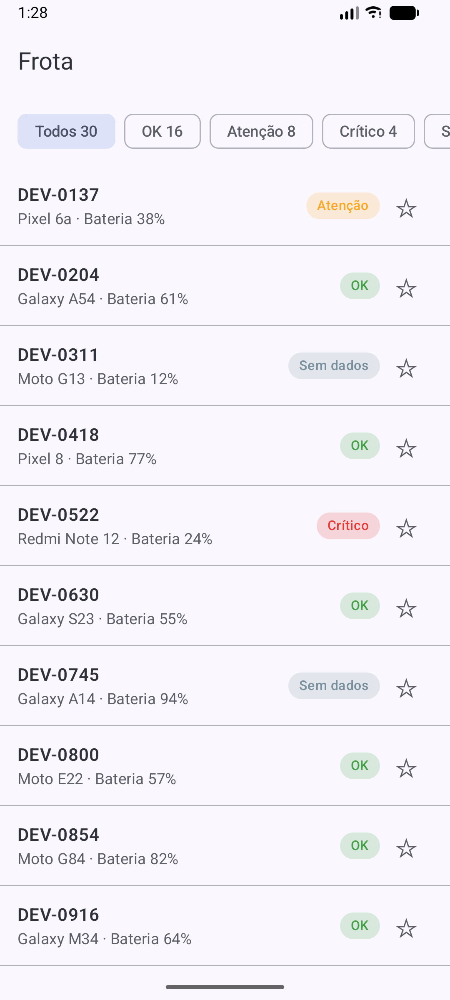
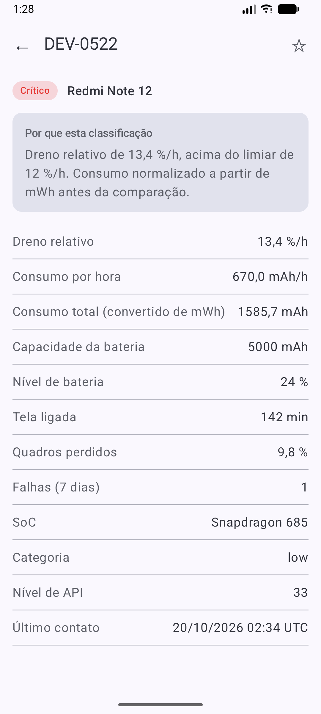

# Seldon Fleet

[](https://github.com/devgabrielbenayon/ProjetoSeldonFleet/actions/workflows/ci.yml)

App Android (Kotlin + Jetpack Compose) que lê a telemetria de uma frota de 30 aparelhos a partir de
`assets/frota.json`, classifica cada um como **OK**, **Atenção**, **Crítico** ou **Sem dados** e
explica o motivo de cada classificação. Funciona sem rede e sem permissão de internet.

| Lista da frota | Detalhe com justificativa |
|---|---|
|  |  |

- **Lista:** id, modelo, nível de bateria, chip de status com cor própria, filtro por status com a
  contagem de cada estado (Todos 30 · OK 16 · Atenção 8 · Crítico 4 · Sem dados 2) e favoritos (★).
- **Detalhe:** atributos com o consumo já normalizado em mAh e a frase que cita o sinal e o valor
  que disparou o estado. O botão voltar do sistema retorna à lista com o mesmo filtro.
- **Favoritos** persistidos em DataStore: sobrevivem ao encerramento completo do app.

## Como rodar

1. Abrir a pasta do projeto no Android Studio e aguardar o *Gradle Sync*.
2. Selecionar um emulador ou aparelho (minSdk 26) e clicar em **Run**.

O projeto usa AGP 9.4, Kotlin 2.2 e **JDK 25** (o JDK embutido no Android Studio atende: *Settings →
Build Tools → Gradle → Gradle JDK*).

## Como testar

```bash
./gradlew test          # Linux/macOS
.\gradlew.bat test      # Windows
```

Todos os testes rodam na JVM, sem emulador. A CI (GitHub Actions) roda `lint` e
`testDebugUnitTest` a cada push.

| Suíte | Testes | O que garante |
|---|---|---|
| `ClassifyDeviceTest` | 32 | Os dois lados de cada limiar (ex.: 11,99 → Atenção, 12,0 → Crítico), registros incompletos sem `NaN`, precedência |
| `DeviceMapperTest` | 14 | mWh → mAh (3773 mWh a 3,85 V = 980 mAh), tensão inválida, unidade desconhecida |
| `FleetParserTest` | 7 | Campo ausente, `null` explícito, chave desconhecida, JSON malformado |
| `FleetPipelineTest` | 7 | O `frota.json` real produz 16/8/4/2 e cada aparelho bate com o gabarito |
| `DataStoreFavoritesRepositoryTest` | 3 | Favoritos persistem após recriar o DataStore |
| `ReasonTextTest` | 8 | A frase do detalhe, incluindo o exemplo da especificação |
| `FleetViewModelTest` | 6 | Contagens, filtro, filtro restaurado, favoritos e erro de leitura, com repositórios *fake* |
| `RefreshPolicyTest` | 9 | Política da atualização periódica: classe do aparelho pela RAM, intervalos e restrições |

Os testes prendem o comportamento: trocar `>=` por `>` na regra, ou desligar a conversão de mWh,
faz a suíte falhar (verificado durante o desenvolvimento).

## Arquitetura

Três camadas, com as dependências apontando para o domínio:

```
   ui  ──────▶  domain  ◀──────  data
(Compose,     (Kotlin puro:    (JSON, conversão
 ViewModel,    regra, modelos,  de unidades,
 navegação)    interfaces)      DataStore)
```

```
app/src/main/java/com/gabbe/seldonfleet/
├── domain/        Device, DeviceStatus, Classification, ClassifyDevice (a regra),
│                  DeviceRepository e FavoritesRepository (interfaces)
├── data/          FleetDto, DeviceMapper (mWh → mAh), FleetParser,
│                  AssetDeviceRepository, DataStoreFavoritesRepository
├── ui/            fleet/ (lista), detail/ (detalhe), navegação, textos e cores
├── work/          atualização periódica com WorkManager (Trilha C)
├── AppContainer.kt    injeção de dependência manual
└── SeldonFleetApp.kt  Application que cria o container
```

- **`domain/` não importa nada do Android.** A regra é testável na JVM, e as interfaces de
  repositório pertencem ao domínio (inversão de dependência). Trocar a fonte de dados por um *fake*
  de teste não exige nenhuma alteração em `domain/`.
- **A unidade é resolvida na fronteira:** o mapper da camada de dados converte mWh para mAh, e o
  domínio só conhece `energyConsumedMah`.
- **A classificação acontece no ViewModel**, chamando o caso de uso, nunca dentro de um Composable
  ou do parser.
- **Textos e cores ficam na UI:** o domínio devolve dados estruturados (sinal, valor observado,
  limiar), e a UI monta a frase em português.
- **Injeção de dependência manual** (`AppContainer`), sem framework: o app tem poucas dependências,
  e o container deixa explícito quem conhece as implementações concretas.

## Decisões de projeto

Todas estão registradas, com alternativas e consequências, em **[PROTOCOLO.md](PROTOCOLO.md)**.
Em resumo:

- **Regra:** limiares de referência da especificação, comparações com `>=`, precedência
  Sem dados → Crítico → Atenção → OK, e dreno *relativo* (%/h), não absoluto.
- **Defeito 1 (unidade):** 10 registros em mWh são convertidos com `mAh = mWh ÷ tensão nominal`.
  Sem a conversão, 8 aparelhos apareceriam como Críticos falsos.
- **Defeito 2 (divisor zero):** DEV-0311 (capacidade 0) e DEV-0745 (tela 0) ficam visíveis como
  **Sem dados**, com o motivo explicado, em vez de serem excluídos ou de derrubarem a leitura.
- **Ausência nunca vira zero:** qualquer campo usado pela regra que falte no arquivo leva a
  "Sem dados", e campos descritivos ausentes aparecem como "—".
- **Ameaça à validade:** o limiar é o mesmo para todos os tiers, mas o aparelho `low` típico desta
  frota já fica acima do limiar de Atenção (mediana de 7,5 %/h contra 5,6 %/h nos `high`).

## Trilha C — Eficiência energética

Atualização periódica da frota com WorkManager: a cada 12 h em aparelhos comuns e a cada 24 h, só
carregando, em aparelhos fracos (detectados pela RAM), sempre com bateria não baixa. A análise
quantitativa — custo estimado por execução, % de bateria por dia em cada frequência, efeito do Doze
e por que a recomendação muda por tier — está em **[TRILHA_C.md](TRILHA_C.md)**.

## Uso de IA

- **Claude:** auxiliou no planejamento do projeto, no desenho do domínio e na escrita do código
  (sugestões de implementação, estrutura das camadas e resolução de erros), além de explicar
  conceitos como camadas, inversão de dependência, coroutines e DataStore.

## O que eu faria em seguida

- **Limiares por tier:** `ClassifyDevice` já recebe `Thresholds` no construtor; bastaria escolher os
  limiares pelo `tier` do aparelho, atacando a ameaça à validade descrita no PROTOCOLO.
- **Testes de UI** com Compose Testing para o fluxo lista → detalhe → voltar com o filtro.
- **Filtro de favoritos** e ordenação por gravidade na lista.
- **Dados vindos de servidor**, com cache local e atualização na frequência em que os dados mudam.
- **Atualizar as dependências** herdadas do template, apontadas como avisos pelo lint.
